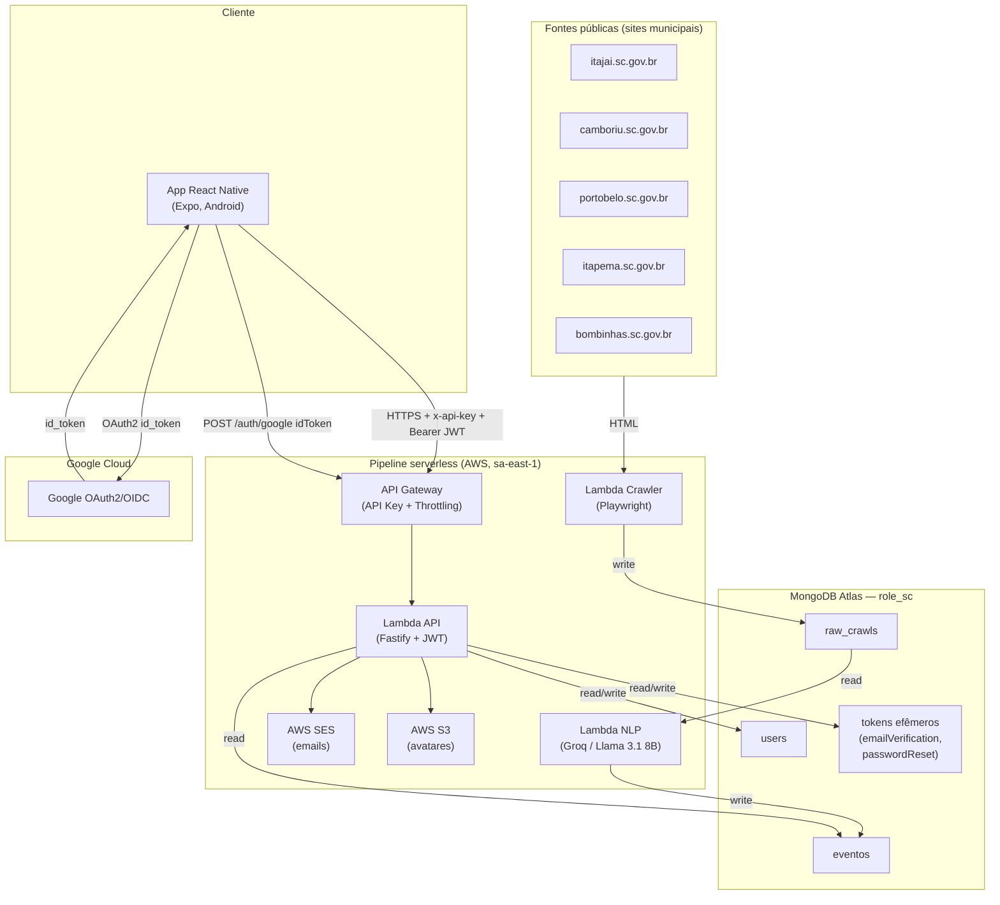
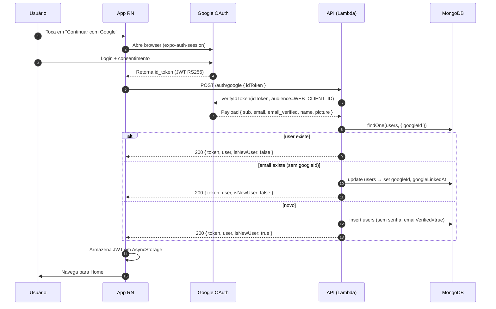
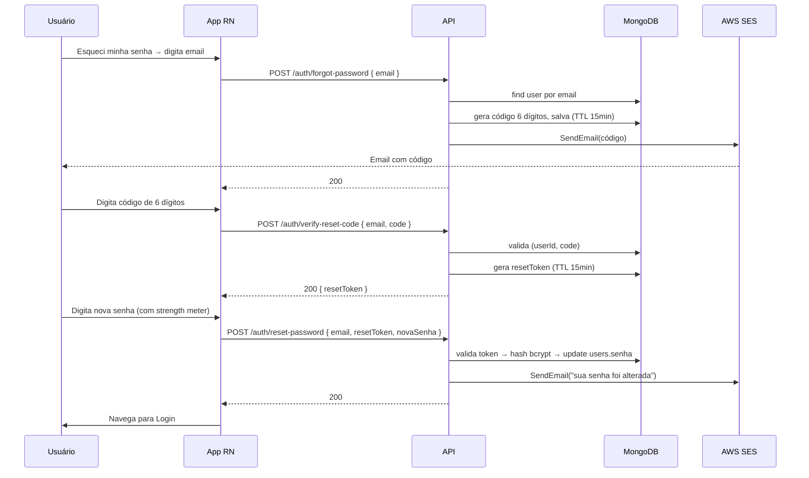
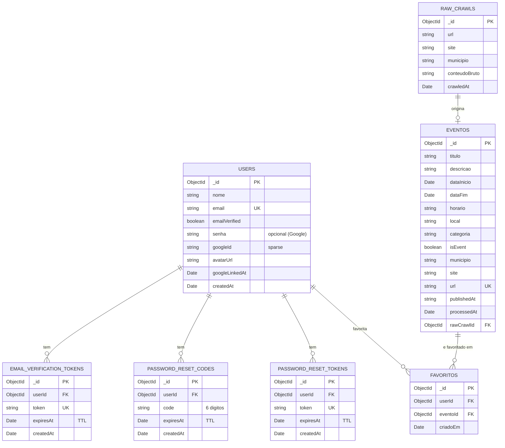
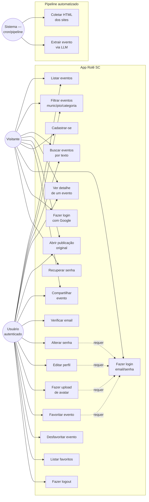

# Rolê SC — Contexto Consolidado para Monografia do TCC

> **Para a IA que vai me ajudar a escrever a monografia:** este documento é a fonte autoritativa do projeto. Ele consolida o backend (`role-sc-api`), o app mobile (`role-sc-frontend`), o crawler (`role-sc-web-crawler`), o processador NLP (`role-sc-processador-nlp-webcrawls`) e todos os contratos de integração já fechados entre os agentes. Sempre que eu te pedir para gerar uma seção do relatório (introdução, fundamentação teórica, modelagem, descrição da solução, conclusão, etc.), use ESTE documento como ponto de partida. Não invente tecnologia, número, ou requisito que não esteja aqui — peça quando estiver na dúvida.

> Cidades-alvo: **Itajaí, Camboriú, Balneário Camboriú, Porto Belo, Itapema, Bombinhas** (SC) — total de 6 municípios.
> Stack-resumo: **React Native + Expo (Android) → AWS API Gateway + Lambda Fastify → MongoDB Atlas ← Lambda NLP (Groq/Llama 3.1 8B) ← Lambda Crawler (Playwright)**.
> Plataforma alvo: **Android** (APK/AAB via EAS; iOS fora do escopo).

---

## 1. Resumo executivo (parágrafo único para abstract/introdução)

O **Rolê SC** é um aplicativo mobile que centraliza eventos culturais, esportivos, gastronômicos, religiosos e comunitários dos municípios do litoral norte de Santa Catarina (Itajaí, Camboriú, Balneário Camboriú, Porto Belo, Itapema, Bombinhas). A informação hoje está pulverizada em **sites de prefeituras, fundações culturais e perfis de redes sociais**, em formatos não estruturados (notícias em HTML, posts em Instagram, PDFs). O sistema usa um pipeline de coleta automática (web crawler com Playwright em AWS Lambda) que extrai HTML bruto dos sites oficiais; em seguida, um processador NLP (Llama 3.1 8B via Groq, também em Lambda) converte cada página em uma estrutura `Evento` (título, data, local, categoria, descrição) ou descarta como "não-evento". Esses eventos ficam disponíveis no MongoDB Atlas e são consumidos por uma API REST (Fastify + JWT) que alimenta um app React Native (Expo, Android). O usuário acessa os eventos filtrando por município, categoria, data e busca textual; pode favoritar eventos (persistidos por usuário no MongoDB, via API), abrir a publicação original em navegador e compartilhar; e tem fluxos completos de cadastro, verificação de email, login (email/senha ou Google), recuperação e alteração de senha, edição de perfil e upload de avatar. O modelo de negócio inicial é **acadêmico/sem fins lucrativos**, com roadmap para sustentabilidade via patrocínio municipal e parcerias com produtores culturais.

---

## 2. Tema, problema e justificativa

### 2.1 Tema
Centralização e estruturação automatizada de eventos públicos do litoral norte catarinense por meio de crawling + extração via LLM, exposto em um app mobile.

### 2.2 Problema
1. **Fragmentação de fontes:** cada prefeitura/fundação cultural publica seus eventos no próprio site, em formato HTML não padronizado. Eventos privados (festas, shows) ficam no Instagram. Não existe um agregador.
2. **Esforço manual de descoberta:** o morador/turista hoje precisa visitar 5+ sites diferentes ou seguir dezenas de perfis para saber "o que vai rolar no fim de semana".
3. **Baixa visibilidade dos eventos municipais:** prefeituras investem em programação cultural mas o alcance é limitado ao já-engajado.
4. **Turismo regional descentralizado:** o litoral catarinense recebe alto fluxo turístico no verão; informação acessível tem impacto econômico mensurável.

### 2.3 Justificativa
- **Tecnológica:** o uso de LLMs para extração estruturada (information extraction) substitui regras frágeis (regex/XPath) com generalização entre sites de prefeituras heterogêneos — caso de uso típico apresentado na literatura recente sobre NLP aplicado a dados públicos.
- **Social:** democratiza acesso a eventos públicos, especialmente os gratuitos, que historicamente sofrem com baixa divulgação.
- **Econômica:** alavanca o turismo regional ao consolidar uma "agenda do litoral" navegável.
- **Acadêmica:** integra múltiplas áreas da computação (engenharia de software, sistemas distribuídos serverless, NLP, mobile, banco de dados NoSQL, autenticação OAuth) em um único produto funcional.

---

## 3. Modelo de negócio

### 3.1 Posicionamento atual
**TCC acadêmico, sem fins lucrativos imediatos.** O foco é demonstrar viabilidade técnica e validar a hipótese de uso. Receita não é objetivo desta fase.

### 3.2 Business Model Canvas resumido

| Bloco | Descrição |
|-------|-----------|
| **Proposta de valor** | "Tudo que vai rolar no litoral norte de SC, num só lugar" — agregador automático, atualizado, gratuito, sem login obrigatório para descobrir eventos. |
| **Segmentos de cliente** | (a) Moradores 18–45 anos que consomem cultura/lazer local; (b) Turistas (alta temporada); (c) Famílias que buscam programação infantil/gratuita; (d) Produtores culturais que querem mais alcance. |
| **Canais** | App Android (Play Store / APK direto). Futuro: site web, push notifications, parceria com guias turísticos digitais. |
| **Relacionamento com cliente** | Self-service no app; futuro: notificações personalizadas, "meus eventos" com lembretes. |
| **Atividades-chave** | Manutenção do crawler (adicionar/corrigir sites), monitoramento da qualidade da extração NLP, evolução do app, suporte. |
| **Recursos-chave** | Pipeline serverless AWS, MongoDB Atlas, créditos Groq (LLM), repositório de fontes mapeadas. |
| **Parceiros** | Prefeituras (oficial ou tácita — usamos dados públicos), produtores culturais, mídia local. |
| **Estrutura de custos** | Hoje: AWS free tier + MongoDB Atlas free tier + Groq free tier ≈ **R$ 0/mês**. Em produção estimada (1k usuários/dia): ~R$ 50–150/mês (Lambda invocations, egress, LLM tokens). |
| **Fontes de receita (roadmap)** | (1) Patrocínio municipal/turístico (prefeituras pagam para destaque); (2) Eventos promovidos (creators pagam para "boost"); (3) Banner de parceiros do trade turístico; (4) Versão "Premium" sem ads e com lembretes inteligentes. **Nenhuma implementada nesta fase.** |

### 3.3 Diferencial competitivo
- **Cobertura geográfica nichada** (5 municípios específicos) com curadoria automatizada, vs. agregadores nacionais que diluem o conteúdo regional.
- **Zero dependência de input manual** dos organizadores (a "matéria-prima" é a página que já existe no site da prefeitura).
- **Categorização semântica** (cultura/esporte/gastronomia/etc.) feita pela IA, não dependente de tag do publicador.

---

## 4. Personas

### 4.1 Persona primária — "Carolina, a moradora antenada"
- **Idade:** 28 anos. **Cidade:** Itajaí.
- **Ocupação:** Designer freelance.
- **Hábitos digitais:** Instagram diário; usa Google Maps, iFood, Spotify; mobile-first.
- **Motivação:** Quer programar fim de semana sem precisar caçar info em 6 sites diferentes.
- **Dor:** Já perdeu festivais gratuitos porque "não soube a tempo". Tem 12 perfis salvos no Instagram e não consegue acompanhar.
- **Cenário de uso típico:** Sexta à noite, abre o app, filtra "Camboriú + Itajaí, Cultura + Gastronomia, fim de semana". Salva 2 eventos nos favoritos. Compartilha um no WhatsApp do grupo de amigas.
- **Critério de sucesso para ela:** Descobriu em 30 segundos algo que valeu a pena ir.

### 4.2 Persona secundária — "Roberto, o turista de verão"
- **Idade:** 42 anos. **Cidade:** Curitiba (visitando Bombinhas em janeiro).
- **Ocupação:** Engenheiro civil. Família com 2 filhos (8 e 12 anos).
- **Hábitos digitais:** Médios. Usa apps de viagem (Booking, Airbnb), TripAdvisor.
- **Motivação:** Achar programação infantil/familiar fora da praia (dias chuvosos, fim de tarde).
- **Dor:** Não conhece o município, não sabe onde olhar.
- **Cenário de uso:** Baixa o app no aeroporto. Filtra "Bombinhas + Cultura + Educação". Encontra contação de história gratuita no Centro Cultural.
- **Critério de sucesso:** O app entregou contexto local que ele não teria de outra forma.

### 4.3 Persona terciária (futuro, não atendida nesta versão) — "Júlio, o produtor cultural"
- **Idade:** 35. **Município:** Porto Belo.
- **Motivação:** Quer divulgar shows que ele produz. Hoje depende de Instagram e flyer.
- **O que ele precisaria do app (fora do escopo do MVP):** painel para cadastrar eventos diretamente, "boostar" um evento, ver métricas de alcance.

---

## 5. Concorrentes e benchmark

### 5.1 Concorrência direta (agregadores de eventos)

| Concorrente | Forma | Cobertura | Fonte dos dados | Pontos fortes | Pontos fracos para SC litoral |
|-------------|-------|-----------|-----------------|---------------|-------------------------------|
| **Sympla** | App + Web | Brasil inteiro, foco em eventos pagos | Cadastro do produtor (input manual) | Marca forte, integração com bilheteria, app maduro | Eventos municipais gratuitos quase nunca aparecem; produtor precisa cadastrar manualmente. |
| **Eventbrite** | App + Web | Global | Cadastro do produtor | Internacionalização, integração com Stripe | Mesmo problema do Sympla; baixa relevância local. |
| **Facebook Events** | Plataforma social | Global | Cadastro do organizador (página) | Volume gigante, integração com convites | Algoritmo do FB diminuiu alcance; perfil etário do litoral migra para Instagram. |
| **Instagram / Stories** | Rede social | Global | Conteúdo livre (não estruturado) | Onde os organizadores realmente postam hoje | Não é busca-friendly, exige seguir muitos perfis, eventos somem após 24h. |
| **Sites das prefeituras (Itajaí, Camboriú, etc.)** | Web | 1 município por site | Publicação manual da assessoria | Fonte oficial, dado bruto confiável | Cada um tem layout próprio; agregação manual é inviável; sem app mobile. |
| **Apps "Visite XYZ"** (ex: Visite Bombinhas, Camboriú Convention) | Mobile | Geralmente 1 município | Curadoria do trade turístico | Foco no turista | Cobertura irregular, qualidade variável, desatualizados, único município. |

### 5.2 Concorrência indireta
- **Google Search / Google Maps "eventos próximos"**: cobertura inconsistente fora de capitais; bom para descoberta aleatória, ruim para planejamento.
- **Grupos de WhatsApp/Telegram locais** ("Eventos Itajaí"): geram engajamento mas exigem o usuário ser convidado e tolerar mensagens off-topic.
- **Rádios e jornais locais** (mídia tradicional): cobertura semanal, não mobile-first, sem filtro.

### 5.3 Tabela-resumo: o que o Rolê SC faz que NENHUM dos acima faz no nicho
1. Agrega **automaticamente** (sem depender do produtor cadastrar) eventos dos 6 municípios-alvo.
2. **Categoriza** com IA, então o usuário filtra por "Esporte" mesmo que o site original não use essa palavra.
3. **Cobertura específica** do litoral norte de SC — agregadores nacionais são "centrais demais", agregadores municipais são "pequenos demais".
4. **Gratuito e sem cadastro obrigatório** para navegar (cadastro só para favoritar/personalizar).

> Para a IA: na seção de "trabalhos correlatos" / "estado da arte" da monografia, contrastar com (a) information extraction de eventos via NLP (literatura acadêmica), (b) apps comerciais como Sympla/Eventbrite (modelo input-manual), (c) agregadores baseados em scraping com regras (modelo frágil, pré-LLM). Posicionar o Rolê SC como combinação **scraping heterogêneo + extração via LLM open-weights + app mobile nichado**.

---

## 6. Stack tecnológica — descrição e justificativa

> Esta seção é a base do capítulo "Tecnologias utilizadas" do TCC. Cada escolha tem justificativa explícita e (quando aplicável) alternativas consideradas e rejeitadas.

### 6.1 Backend — API REST (`role-sc-api`)

| Tecnologia | Versão | Papel | Justificativa |
|-----------|--------|------|---------------|
| **TypeScript** | 5.x | Linguagem | Tipagem forte, integração nativa com Fastify/Mongo, mesmo padrão dos outros 3 repos do ecossistema. |
| **Node.js** | 24.x | Runtime | Runtime padrão das Lambdas; suporte a top-level await; alta performance em I/O bound (o caso aqui). |
| **Fastify** | 5.8 | Framework HTTP | ~2x mais performático que Express; validação nativa via JSON Schema (sem libs extras tipo Zod no runtime); ecossistema de plugins maduro; integração oficial com Lambda via `@fastify/aws-lambda`. |
| **@fastify/aws-lambda** | 6.4 | Adapter Lambda | Converte requests do API Gateway para o ciclo Fastify sem hack. |
| **mongodb (driver oficial)** | 7.1 | Cliente Mongo | Driver oficial; sem overhead de ODM (Mongoose) — alinhado com modelagem schema-flexível usada no NLP. |
| **bcryptjs** | 3.0 | Hash de senha | **Escolhido em vez de bcrypt nativo** porque o esbuild não empacota binários nativos na Lambda; API idêntica. |
| **jsonwebtoken** | 9.0 | JWT | Padrão da indústria; HS256, expiração configurável (`JWT_EXPIRES_IN`, padrão `7d`). |
| **google-auth-library** | (a instalar pelo backend) | Validação id_token Google | Lib oficial Google; valida assinatura RS256, audience e expiração do id_token em uma chamada. |
| **@aws-sdk/client-sesv2** | a instalar | Envio de email | SDK v3 modular; integra-se com IAM da Lambda sem credencial em código. |
| **@aws-sdk/client-s3** + **@aws-sdk/s3-request-presigner** | a instalar | Avatar upload | Geração de presigned URLs para PUT direto no S3. |
| **esbuild** | 0.28 | Bundler | Empacota tudo num único `dist/handler.js` CJS (formato exigido pela Lambda). |
| **pnpm** | latest | Package manager | Lockfile determinístico, instalação rápida, mesmo padrão dos outros repos. |

**Decisão arquitetural-chave:** **Lambda em vez de container EC2/ECS** porque o tráfego é spiky (picos no fim de semana, baixíssimo em horário comercial); cold start é tolerável em app mobile (<1s com 256MB).

### 6.2 Frontend — App Mobile (`role-sc-frontend`)

| Tecnologia | Versão | Papel | Justificativa |
|-----------|--------|------|---------------|
| **React Native** | 0.81 | Framework UI mobile | Permite código compartilhado iOS/Android; comunidade enorme; perfeito para apps "content-heavy" como agregadores. |
| **Expo SDK** | 54 | Plataforma | Acelera desenvolvimento (sem Android Studio na DX inicial); EAS Build para builds na nuvem; OTA updates; abstrações para câmera, image picker, web browser, etc. |
| **TypeScript** | 5.9 | Linguagem | Consistência com o backend; pega bugs cedo, especialmente em respostas de API. |
| **React Navigation** | 7 | Navegação | Padrão de fato em RN; suporta stack nativo (`native-stack`) com transições fluidas + bottom tabs. |
| **Axios** | 1.7 | HTTP client | API ergonômica, interceptors para `x-api-key` (API Gateway) e `Authorization: Bearer` (JWT); centraliza tratamento de 401 → logout. |
| **AsyncStorage** | 2.2 | Persistência local | Padrão RN para key-value; armazena JWT e user (sessão). Favoritos NÃO ficam aqui — são por usuário, no servidor. |
| **Context API** | nativo | Estado global | Suficiente para auth e favoritos globais (single source of truth); evita overkill de Redux/Zustand para o escopo. |
| **expo-auth-session** + **expo-crypto** | 7.0 / 15.0 | OAuth Google | Implementa o fluxo OpenID Connect (`id_token`) sem precisar de SDK proprietário do Google. |
| **expo-image-picker** | 17.0 | Captura/seleção de foto | Avatar do usuário (câmera ou galeria) com permissões nativas. |
| **expo-file-system** | 19.0 | Upload | Necessário para o PUT no S3 (presigned URL). |
| **expo-web-browser** | 15.0 | Browser in-app | Abre a publicação original do evento (Custom Tabs no Android) sem sair do app. |
| **expo-linear-gradient** | 15.0 | UI | Gradientes do tema (cards de eventos por categoria, avatar fallback, tabs ativas). |
| **@expo/vector-icons** (Ionicons) | 15.0 | Ícones | Set completo, sem assets adicionais. |
| **react-native-safe-area-context** | 5.6 | Safe area | Lida com notch/barra de status nas telas Android modernas. |
| **react-native-gesture-handler** | 2.28 | Gestos | Pré-requisito do React Navigation para gestos nativos. |
| **EAS Build / EAS Submit / EAS Update** | CLI 13+ | Build & publish | Build APK/AAB na nuvem (free tier 30 builds/mês), submissão automatizada ao Play Console, OTA updates para hotfixes JS. |

**Decisão arquitetural-chave:** **Expo (managed) em vez de RN bare** porque o app não precisa de módulos nativos customizados; ganho enorme de produtividade vs. perda zero de funcionalidade.

**Plataforma:** **Android only** no MVP. iOS exige conta Apple Developer (US$ 99/ano) e dispositivo macOS para testes — fora do escopo do TCC. A arquitetura está pronta para iOS quando quiser.

### 6.3 Web Crawler (`role-sc-web-crawler`)

| Tecnologia | Papel | Justificativa |
|-----------|------|---------------|
| **Playwright** | Headless browser | Necessário porque sites de prefeituras usam JS para renderizar listas de notícias; Cheerio sozinho falharia. Suporta Chromium em Lambda via layer customizada. |
| **AWS Lambda** | Execução agendada | Cron via EventBridge; serverless paga só pelo tempo de execução; sem servidor para manter. |
| **MongoDB Atlas (`raw_crawls`)** | Storage do bruto | Salva HTML/texto bruto com URL, fonte, timestamp. Mantém a "matéria-prima" rastreável para auditoria do pipeline. |

### 6.4 NLP Processor (`role-sc-processador-nlp-webcrawls`)

| Tecnologia | Papel | Justificativa |
|-----------|------|---------------|
| **Groq Cloud (inferência LLM)** | Provedor de inferência | Latência absurdamente baixa (~250ms para Llama 3.1 8B vs. ~3-5s OpenAI), free tier generoso; única alternativa "produção-ready" gratuita no momento. |
| **Llama 3.1 8B Instruct** | Modelo de extração | Modelo open-weights da Meta; suficiente para extração estruturada (não precisa de raciocínio complexo); custo zero via Groq. |
| **AWS Lambda + EventBridge** | Orquestração | Processa `raw_crawls` recém-criados; idempotente. |
| **MongoDB Atlas (`eventos`)** | Output estruturado | Coleção com schema fixo de evento (título, datas, categoria, etc.) + flag `isEvent` para descartar notícias que não são eventos. |

**Decisão arquitetural-chave:** **LLM em vez de regras (regex/XPath)** porque cada prefeitura tem um layout diferente; criar/manter parsers por site é insustentável. A IA generaliza com poucos-shots no system prompt.

### 6.5 Infraestrutura AWS

| Recurso | Papel | Configuração |
|--------|------|--------------|
| **AWS Lambda** | Runtime serverless | Node.js 24, 256 MB, timeout 30s, região `sa-east-1`. |
| **API Gateway REST** | Edge da API | Validação de `x-api-key`, throttling (50 req/s, burst 25), quota diária 10k req. |
| **API Gateway Usage Plan + API Key** | Throttling | Bloqueia 403 antes de invocar a Lambda. |
| **S3 (`role-sc-avatars`)** | Storage de avatares | Bucket público para leitura (`avatars/*`), CORS para GET/PUT/HEAD, presigned URLs para upload. |
| **SES** | Envio de emails | Verificação de email, recuperação/alteração de senha. Sandbox no MVP. |
| **MongoDB Atlas** | Banco principal | Cluster M0 free tier; 5 coleções (`raw_crawls`, `eventos`, `users`, `emailVerificationTokens`, `passwordResetCodes`, `passwordResetTokens`); TTL indexes para tokens efêmeros. |
| **EAS (Expo Cloud)** | Builds mobile | APK (preview) e AAB (production). |
| **Google Cloud Console** | OAuth 2.0 / OIDC | OAuth Consent Screen (Testing) + 2 OAuth Client IDs (Web para Expo Go, Android para APK). |

### 6.6 Padrões e arquitetura de software aplicados

| Padrão | Onde se aplica |
|--------|----------------|
| **Repository Pattern** | Backend (`src/database/repositories/*`) — separa lógica de acesso ao banco do serviço. |
| **Service Layer** | Backend (`src/services/*`) e frontend (`src/services/*`) — lógica de negócio fora das rotas/telas. |
| **Singleton (lazy)** | Conexão MongoDB no backend é reaproveitada entre invocações Lambda (warm starts). |
| **JSON Schema Validation** | Validação de request body/query no Fastify, sem libs extras. |
| **Interceptors** | Frontend (`src/services/api.ts`) — injeta headers e trata 401 globalmente. |
| **Context Provider** | Frontend (`AuthContext`, `FavoritosContext`) — estado global de autenticação e de favoritos. |
| **Custom Hooks** | Frontend (`useEventos`, `useGoogleSignIn`, `useAvatarUpload`) — encapsula efeitos e estado local. |
| **Fastify Hooks (preHandler)** | Backend (`auth.hook.ts`) — autenticação JWT em rotas protegidas (não middleware Express-style). |
| **Antienumeration** | Endpoints de auth retornam mensagens genéricas em alguns casos (resend-verification, login com senha incorreta) para não vazar se um email existe. |
| **TTL Indexes** | Tokens efêmeros (verificação de email, códigos/tokens de reset de senha) auto-deletados pelo Mongo. |
| **Cache busting via querystring** | URL do avatar com `?v={timestamp}` força recarga após upload. |
| **Single-use tokens** | Reset de senha (código de 6 dígitos + resetToken) são deletados após uso. |

---

## 7. Arquitetura geral do sistema

### 7.1 Visão lógica (texto)

```
┌──────────────────────────────────────────────────────────────────────────┐
│                          FONTES DE DADOS PÚBLICAS                         │
│  Sites: itajai.sc.gov.br · camboriu.sc.gov.br · portobelo.sc.gov.br ·    │
│         itapema.sc.gov.br · bombinhas.sc.gov.br · fundações culturais     │
└──────────────────────────────────────────────────────────────────────────┘
                                      │ (HTTP)
                                      ▼
┌──────────────────────────────────────────────────────────────────────────┐
│  LAMBDA #1: role-sc-web-crawler (Playwright, agendado via EventBridge)   │
│  → Navega, extrai texto/HTML bruto, salva em raw_crawls                  │
└──────────────────────────────────────────────────────────────────────────┘
                                      │ (write)
                                      ▼
┌──────────────────────────────────────────────────────────────────────────┐
│       MongoDB Atlas — Database `role_sc`                                  │
│  Coleção: raw_crawls (HTML/texto bruto + metadata da fonte)              │
└──────────────────────────────────────────────────────────────────────────┘
                                      │ (read)
                                      ▼
┌──────────────────────────────────────────────────────────────────────────┐
│  LAMBDA #2: role-sc-processador-nlp-webcrawls                            │
│  → Para cada raw_crawl, chama Groq (Llama 3.1 8B) com prompt de         │
│    extração estruturada → gera Evento ou marca isEvent=false             │
└──────────────────────────────────────────────────────────────────────────┘
                                      │ (write)
                                      ▼
┌──────────────────────────────────────────────────────────────────────────┐
│       MongoDB Atlas — Coleção `eventos` (estruturada)                     │
└──────────────────────────────────────────────────────────────────────────┘
                                      │ (read)
                                      ▼
┌──────────────────────────────────────────────────────────────────────────┐
│  AWS API Gateway REST (region: sa-east-1)                                │
│  → Valida x-api-key, aplica throttling/quota                            │
└──────────────────────────────────────────────────────────────────────────┘
                                      │
                                      ▼
┌──────────────────────────────────────────────────────────────────────────┐
│  LAMBDA #3: role-sc-api (Fastify + JWT)                                  │
│  → Endpoints REST: /auth/*, /eventos, /municipios, /categorias,         │
│    /users/me, /users/me/avatar/*                                        │
│  → Persiste users, tokens efêmeros · Lê eventos · Integra SES, S3       │
└──────────────────────────────────────────────────────────────────────────┘
       │              │              │
       │              │              ▼
       │              │       ┌────────────────┐
       │              │       │  AWS S3        │  (avatares públicos)
       │              │       └────────────────┘
       │              ▼
       │       ┌────────────────┐
       │       │  AWS SES       │  (emails de verificação e reset)
       │       └────────────────┘
       ▼
┌──────────────────────────────────────────────────────────────────────────┐
│  APP REACT NATIVE (Expo) — Android                                       │
│  · AuthContext, RootNavigator, AuthNavigator, AppNavigator              │
│  · Telas: Login, Cadastro, Verificar email, Recuperar senha,            │
│    Confirmar código, Redefinir senha, Home (eventos), Detalhe evento,   │
│    Favoritos, Perfil, Editar perfil, Alterar senha                      │
│  · Integração OAuth Google direta (expo-auth-session) → id_token →      │
│    backend exchange por JWT                                              │
└──────────────────────────────────────────────────────────────────────────┘
```

### 7.2 Diagrama de arquitetura (Mermaid — copie para o relatório)



### 7.3 Diagrama de sequência — login com Google (Mermaid)



### 7.4 Diagrama de sequência — recuperação de senha (Mermaid)



---

## 8. Modelagem do banco de dados

> Banco: MongoDB Atlas (NoSQL document-oriented). Database: `role_sc`. Coleções abaixo. Embora seja NoSQL, modelamos os "objetos" e "relacionamentos" como em um DER tradicional para apresentação acadêmica.

### 8.1 Coleções (descrição)

#### `raw_crawls`
Bruto extraído pelo crawler. Não tem schema rígido — campos típicos: `_id`, `url`, `site`, `municipality`, `title`, `rawText`, `publishedAt`, `imageUrl`, `crawledAt`, `processed`.

#### `eventos` (consumida pela API, alimentada pelo NLP)
```typescript
{
  _id: ObjectId,
  titulo: string,
  descricao: string | null,
  dataInicio: Date | null,
  dataFim: Date | null,
  horario: string | null,
  local: string | null,
  categoria: 'Cultura'|'Esporte'|'Gastronomia'|'Educação'|'Saúde'|'Meio Ambiente'|'Turismo'|'Religião'|'Outro' | null,
  imageUrl?: string | null,    // capa extraída pelo crawler (raw_crawls.imageUrl); opcional
  isEvent: boolean,            // false = a IA classificou como "não-evento" (notícia comum)
  municipio: string,
  site: string,
  url: string,                 // único
  publishedAt: string,         // como veio do site, livre
  processedAt: Date,
  rawCrawlId: ObjectId         // referência ao raw_crawls que originou
}
```
**Índices:**
- `{ url: 1 }` único
- `{ municipio: 1, isEvent: 1 }` composto
- `{ dataInicio: 1 }`

#### `users`
```typescript
{
  _id: ObjectId,
  nome: string,
  email: string,                 // único, lowercase
  emailVerified: boolean,
  senha?: string,                // hash bcrypt; opcional (users do Google podem não ter)
  googleId?: string,             // sub do id_token Google; permite linking
  avatarUrl?: string,            // URL S3 pública com cache-bust ?v=
  googleLinkedAt?: Date,
  createdAt: Date
}
```
**Índices:**
- `{ email: 1 }` único
- `{ googleId: 1 }` sparse

#### `emailVerificationTokens` (TTL)
```typescript
{
  _id: ObjectId,
  userId: ObjectId,
  token: string,                 // hex 32 bytes (64 chars)
  expiresAt: Date,               // now + 24h
  createdAt: Date
}
```
**Índices:**
- `{ expiresAt: 1 }` TTL (`expireAfterSeconds: 0`)
- `{ token: 1 }` único
- `{ userId: 1 }`

#### `passwordResetCodes` (TTL)
```typescript
{
  _id: ObjectId,
  userId: ObjectId,
  code: string,                  // 6 dígitos numéricos
  expiresAt: Date,               // now + 15min
  createdAt: Date
}
```
**Índices:**
- `{ expiresAt: 1 }` TTL
- `{ userId: 1 }`

#### `passwordResetTokens` (TTL)
```typescript
{
  _id: ObjectId,
  userId: ObjectId,
  token: string,                 // hex 32 bytes (após validar o código)
  expiresAt: Date,               // now + 15min
  createdAt: Date
}
```
**Índices:**
- `{ expiresAt: 1 }` TTL
- `{ token: 1 }` único

### 8.2 Diagrama de entidades (Mermaid ER)



### 8.3 Relacionamentos (cardinalidade)
- `users` → `emailVerificationTokens`: 1:N (mas tipicamente 0..1 ativo por vez).
- `users` → `passwordResetCodes`/`passwordResetTokens`: 1:N (com cleanup ao usar).
- `raw_crawls` → `eventos`: 1:1 (cada crawl gera no máximo 1 evento; pode gerar 0 se `isEvent=false`).
- `users` → `favoritos` ← `eventos`: N:N resolvida pela coleção associativa `favoritos` (um documento por par usuário/evento, com índice único em `{ userId, eventoId }`).

---

## 9. Requisitos Funcionais (RF)

> Convenção: RFnn = requisito funcional. Status: ✅ implementado · 🟡 implementado no app, aguardando backend · ⏳ não implementado.

### 9.1 Eventos (consulta)
| ID | Descrição | Status |
|----|-----------|--------|
| RF01 | O sistema deve listar eventos paginados (20 por página, máx. 50). | ✅ |
| RF02 | O usuário deve poder filtrar eventos por município (Itajaí, Camboriú, Balneário Camboriú, Porto Belo, Itapema, Bombinhas). | ✅ |
| RF03 | O usuário deve poder filtrar eventos por categoria (Cultura, Esporte, Gastronomia, Educação, Saúde, Meio Ambiente, Turismo, Religião, Outro). | ✅ |
| RF04 | O usuário deve poder filtrar por intervalo de datas (`dataInicio`, `dataFim`). | ✅ (backend) / 🟡 (UI "Período" desabilitada) |
| RF05 | O usuário deve poder buscar por texto livre (no título e descrição). | ✅ |
| RF06 | O sistema deve permitir scroll infinito + pull-to-refresh na listagem. | ✅ |
| RF07 | O sistema deve mostrar o detalhe completo de um evento (título, descrição, datas, horário, local, categoria, município, fonte). | ✅ |
| RF08 | O usuário deve poder abrir a publicação original do evento em browser in-app. | ✅ |
| RF09 | O usuário deve poder compartilhar um evento via Share nativo do Android. | ✅ |
| RF10 | O sistema deve retornar a lista de municípios que efetivamente têm eventos (`GET /municipios`). | ✅ |
| RF11 | O sistema deve retornar a lista fixa de categorias válidas (`GET /categorias`). | ✅ |

### 9.2 Autenticação
| ID | Descrição | Status |
|----|-----------|--------|
| RF12 | O usuário deve poder se cadastrar com nome, email e senha. | ✅ |
| RF13 | O usuário deve verificar o email via link clicável antes de logar (token 24h). | 🟡 frontend pronto |
| RF14 | O usuário deve poder reenviar o email de verificação (cooldown 60s). | 🟡 frontend pronto |
| RF15 | O usuário deve poder fazer login com email e senha, recebendo um JWT (7 dias). | ✅ |
| RF16 | O usuário deve poder fazer login/cadastro com Google (OAuth 2.0 / OIDC). | 🟡 frontend pronto |
| RF17 | O sistema deve fazer linking automático de conta Google quando o email coincide com conta existente. | 🟡 frontend pronto |
| RF18 | O usuário deve poder solicitar recuperação de senha por código de 6 dígitos enviado por email (TTL 15min). | 🟡 frontend pronto |
| RF19 | O usuário deve poder confirmar o código e definir nova senha (com checklist de força em tempo real). | 🟡 frontend pronto |
| RF20 | O usuário logado deve poder alterar sua senha (exigindo a senha atual). | 🟡 frontend pronto |
| RF21 | O sistema deve fazer logout automático em caso de 401 vindo do backend. | ✅ |

### 9.3 Perfil
| ID | Descrição | Status |
|----|-----------|--------|
| RF22 | O usuário deve poder visualizar seu perfil (nome, email, avatar). | ✅ |
| RF23 | O usuário deve poder editar seu nome de exibição (entre 2 e 80 caracteres). | 🟡 frontend pronto |
| RF24 | O usuário deve poder fazer upload de avatar (JPEG/PNG/WebP/GIF, máx. 5 MB) via S3 com presigned URL. | 🟡 frontend pronto |
| RF25 | O sistema deve mostrar fallback (gradiente com inicial do nome) quando o usuário não tem avatar. | ✅ |
| RF26 | O usuário deve poder fazer logout. | ✅ |

### 9.4 Favoritos
| ID | Descrição | Status |
|----|-----------|--------|
| RF27 | O usuário deve poder favoritar/desfavoritar um evento. | ✅ (server-side, coleção `favoritos`) |
| RF28 | O usuário deve poder visualizar a lista de favoritos numa aba dedicada. | ✅ |
| RF29 | O usuário deve poder navegar do favorito direto para o detalhe do evento. | ✅ |

### 9.5 Comentários, curtidas, "eu vou" (futuro)
| ID | Descrição | Status |
|----|-----------|--------|
| RF30 | (Futuro) O usuário deve poder curtir um evento. | ⏳ stub UI |
| RF31 | (Futuro) O usuário deve poder comentar em um evento. | ⏳ stub UI |
| RF32 | (Futuro) O usuário deve poder marcar "eu vou" em um evento. | ⏳ stub UI |

---

## 10. Requisitos Não-Funcionais (RNF)

| ID | Categoria | Descrição |
|----|-----------|-----------|
| RNF01 | Performance — API | Latência p95 < 500 ms para `GET /eventos` (Lambda 256 MB, MongoDB Atlas M0, mesma região `sa-east-1`). |
| RNF02 | Performance — App | Tempo até primeiro render dos eventos < 2 s em rede 4G. |
| RNF03 | Performance — NLP | Inferência LLM < 1 s por documento (Groq + Llama 3.1 8B). |
| RNF04 | Segurança — Auth | Senhas armazenadas com bcrypt (10 rounds). Tokens efêmeros (verificação de email, código/token de reset) gerados com `crypto.randomBytes`/`crypto.randomInt` (PRNG criptográfico), nunca `Math.random()`. |
| RNF05 | Segurança — JWT | Assinado com HS256, secret em variável de ambiente (`JWT_SECRET`), expiração 7 dias. |
| RNF06 | Segurança — Transporte | Toda comunicação app↔API via HTTPS (TLS 1.2+) provido pelo API Gateway. |
| RNF07 | Segurança — Edge | API Gateway aplica throttling (50 req/s, burst 25) e quota (10k req/dia) antes da Lambda. |
| RNF08 | Segurança — Google OAuth | id_token sempre validado criptograficamente server-side com `google-auth-library` (assinatura RS256, audience = WEB_CLIENT_ID, `email_verified=true` obrigatório). Backend nunca confia no payload decodificado sem `verifyIdToken`. |
| RNF09 | Segurança — Antienumeration | Endpoints sensíveis (resend-verification, login com user inexistente) retornam mensagens genéricas. Exceção consciente: `forgot-password` retorna 404 explícito (decisão de produto). |
| RNF10 | Segurança — Logs | Senhas, tokens, `Authorization`, `senhaAtual`, `novaSenha`, código de reset e id_token nunca são logados, nem em dev. |
| RNF11 | Segurança — Email verification | Email só é considerado verificado quando o usuário clica no link (token hex 32 bytes, TTL 24h). Login bloqueado com 403 `EMAIL_NOT_VERIFIED` para emails não verificados. |
| RNF12 | Segurança — Avatar | Validação dupla (cliente + servidor HEAD no S3) de Content-Type e Content-Length. Key sempre derivada do JWT (`avatars/{userId}`) — usuário não pode confirmar avatar de outro. |
| RNF13 | Confiabilidade | A coleta (crawler) e o processamento (NLP) são idempotentes. Cada `url` tem índice único em `eventos` para evitar duplicatas. |
| RNF14 | Manutenibilidade — Arquitetura | 4 repositórios independentes com responsabilidade única (crawler, NLP, API, app). Não há acoplamento de código entre eles — apenas o schema das coleções é o "contrato". |
| RNF15 | Manutenibilidade — Padrões | Repository Pattern, Service Layer, hooks customizados, validação via JSON Schema. Documentos de contrato versionados (`docs/CONTRATO_*.md`) para qualquer integração nova. |
| RNF16 | Portabilidade | A arquitetura serverless permite mover de `sa-east-1` para outra região via redeploy do `template.yaml` (SAM). |
| RNF17 | Escalabilidade | Lambda escala horizontalmente sem configuração. Throttling do API Gateway protege os limites de plano gratuito do Atlas. |
| RNF18 | Usabilidade — UX | Strength meter ao vivo nos campos de senha (cadastro, reset, alteração). Códigos de erro semânticos (`code` em respostas 4xx) para feedback específico (ex.: senha atual incorreta, código inválido, email não verificado). |
| RNF19 | Usabilidade — Mobile | App suporta orientação portrait apenas, Android. Status bar dark icons, safe areas respeitadas, scroll infinito + pull-to-refresh em listas grandes. |
| RNF20 | Acessibilidade | Labels acessíveis em ícones interativos (`accessibilityLabel`), suporte a tamanhos de toque mínimos (hitSlop). Não há suporte explícito a leitor de tela ainda (anotado como roadmap). |
| RNF21 | Internacionalização | UI em pt-BR. Datas formatadas no formato local. Não há i18n no MVP (escopo: Brasil/SC). |
| RNF22 | Disponibilidade | SLA herdado da AWS Lambda (99,95%) e MongoDB Atlas free tier (best-effort). |
| RNF23 | Custo | Operação dentro do free tier de AWS, MongoDB Atlas, Groq e EAS no MVP. Custo marginal estimado: < R$ 50/mês para 1000 usuários ativos/dia. |
| RNF24 | Tamanho do APK | < 60 MB (sem assets pesados; usa CDN para imagens de eventos no roadmap). |
| RNF25 | Compatibilidade | Android 7.0+ (API level 24+), conforme baseline do Expo SDK 54. |
| RNF26 | Conformidade — LGPD | App coleta dados pessoais mínimos (nome, email, senha hash, foto opcional). Política de privacidade a publicar antes da Play Store pública (anotado). |

---

## 11. Regras de Negócio (RN)

| ID | Regra |
|----|-------|
| RN01 | A API **só retorna** eventos com `isEvent: true`. Documentos classificados pela IA como "não-evento" (notícias comuns) ficam invisíveis ao usuário final. |
| RN02 | A ordenação padrão da listagem é `dataInicio` decrescente (eventos mais recentes/próximos primeiro). |
| RN03 | A paginação padrão é 20 itens por página, com máximo de 50. |
| RN04 | A lista de **municípios fixos** exibida no app é: Itajaí, Camboriú, Balneário Camboriú, Porto Belo, Itapema, Bombinhas. A API pode retornar um subconjunto (`GET /municipios`) com apenas os que têm eventos, mas o app sempre mostra os 6 para consistência da UX. |
| RN05 | As **categorias válidas** são exatamente: Cultura, Esporte, Gastronomia, Educação, Saúde, Meio Ambiente, Turismo, Religião, Outro. Devem ficar em sincronia entre NLP, API e app. |
| RN06 | O **email** deve ser único na base (índice único em `users.email`, sempre lowercase). |
| RN07 | Para criar conta, o usuário **deve verificar o email** clicando no link (token hex 32 bytes, TTL 24h). Login bloqueado até a verificação (403 `EMAIL_NOT_VERIFIED`). |
| RN08 | Senhas devem cumprir: ≥ 8 caracteres, ao menos 1 maiúscula, 1 minúscula, 1 dígito, 1 caractere especial. Validação client-side e server-side. |
| RN09 | O JWT expira em **7 dias**. Após expirar, qualquer 401 vindo do backend força logout automático no app. |
| RN10 | O reenvio de email de verificação tem cooldown de **60 segundos** (server-side rate limit), espelhado client-side. |
| RN11 | O código de reset de senha tem **6 dígitos numéricos**, gerado com `crypto.randomInt`, TTL **15 minutos**, single-use. Lookup sempre por `(userId, code)`, nunca só por `code`. |
| RN12 | Após validar o código, o usuário recebe um `resetToken` (hex 32 bytes, TTL 15min, single-use) para de fato trocar a senha. |
| RN13 | Após reset de senha bem-sucedido, **todos** os códigos e tokens pendentes daquele usuário são deletados (cleanup completo). Email de notificação "sua senha foi alterada" é enviado (best-effort, não bloqueante). |
| RN14 | Login com Google: validação criptográfica do id_token é **obrigatória**; `email_verified=true` no payload é **obrigatório**; audience deve ser igual a `GOOGLE_WEB_CLIENT_ID`. Sem esses 3, recusa. |
| RN15 | Linking automático Google + conta existente acontece **apenas se** email coincide E `email_verified=true`. Caso contrário, recusa com mensagem clara. |
| RN16 | Usuários criados via Google não têm senha. Tentar login email/senha nessas contas retorna 400 `PASSWORD_NOT_SET` com sugestão "Entre com o Google". |
| RN17 | Avatar do usuário Google: usa diretamente a URL do `picture` do id_token (sem cópia para o S3). |
| RN18 | Avatar via upload: tipos aceitos `image/jpeg | png | webp | gif`, tamanho ≤ 5 MB, key sempre `avatars/{userId}` (sobrescreve), cache-bust por `?v={timestamp}` na URL pública. |
| RN19 | **Email não é editável** após o cadastro (decisão de produto). Apenas `nome` é editável via `PATCH /users/me`, entre 2 e 80 caracteres (após trim). |
| RN20 | Alterar senha (usuário logado) exige **senha atual** como prova de identidade (defesa contra JWT vazado), nova senha deve cumprir as regras de força e ser diferente da atual. |
| RN21 | Favoritos são por **usuário**, não por dispositivo: ficam na coleção `favoritos` do MongoDB e acompanham a conta em qualquer aparelho. As rotas derivam o dono do JWT — não existe forma de ler ou alterar favoritos de outra pessoa. Favoritar/desfavoritar é idempotente. |
| RN22 | Compartilhamento de evento usa a `Share API` nativa do Android, com mensagem composta de título + descrição + URL original. |
| RN23 | **Antienumeration**: `resend-verification` sempre retorna 200 com mensagem genérica, mesmo se o email não existir. **Exceção consciente**: `forgot-password` retorna 404 explícito (decisão pragmática: "app de eventos locais não é banco"). |
| RN24 | Toda request ao backend exige o header `x-api-key` (verificado pelo API Gateway antes da Lambda). Rotas protegidas exigem adicionalmente `Authorization: Bearer <jwt>`. |
| RN25 | A categorização (campo `categoria` do evento) é definida pela IA no momento do processamento; o usuário não pode editar. Caso ela falhe, fica `null` e o app exibe gradiente "Outro". |
| RN26 | A capa do evento (listagem e detalhe) usa a imagem de destaque extraída pelo crawler (`imageUrl`). Quando o evento não tem imagem, ou quando a URL falha ao carregar, o app exibe o placeholder de gradiente + ícone da categoria. A imagem é sempre servida pela URL original do site da prefeitura — não há cópia para o S3. |

---

## 12. Casos de Uso

### 12.1 Diagrama de casos de uso (Mermaid)



### 12.2 Descrição detalhada dos casos de uso principais (template para a monografia)

#### UC01 — Listar eventos
- **Atores:** Visitante, Usuário autenticado.
- **Pré-condições:** App aberto. Conexão de rede disponível.
- **Fluxo principal:**
  1. O usuário entra na aba "Eventos".
  2. O app chama `GET /eventos?page=1&limit=20`.
  3. A API retorna os 20 eventos mais recentes com `isEvent: true`.
  4. O app renderiza a lista em cards com cover gradiente por categoria.
- **Fluxos alternativos:**
  - Scroll até o fim → `loadMore()` chama `?page=2`.
  - Pull-to-refresh → recarrega `?page=1`.
- **Pós-condições:** Eventos exibidos.
- **Exceções:** Falha de rede → mostra mensagem de erro no topo da lista.

#### UC04 — Ver detalhe de um evento
- **Atores:** Visitante, Usuário.
- **Pré-condições:** Lista de eventos carregada.
- **Fluxo principal:**
  1. Usuário toca em um card.
  2. App navega para `DetalheEvento` passando o `id`.
  3. App chama `GET /eventos/:id`.
  4. Exibe título, descrição, datas, horário, local, categoria, município, fonte, botão para abrir URL original, botão de compartilhar, botão de favoritar, botão de comentários (stub).
- **Exceções:** 404 → mostra "Evento não encontrado".

#### UC07 — Cadastrar-se
- **Atores:** Visitante.
- **Pré-condições:** Email não cadastrado.
- **Fluxo principal:**
  1. Visitante toca em "Criar conta".
  2. Preenche nome, email, senha (com strength meter), confirma senha.
  3. App valida (regex de senha, formato de email, senhas iguais).
  4. App envia `POST /auth/register`.
  5. Backend: hash bcrypt, insere user com `emailVerified=false`, gera token de verificação 32 bytes, envia email via SES, responde 201.
  6. App navega para `VerificarEmail` passando o email.
- **Fluxos alternativos:**
  - Cadastro via Google → `POST /auth/google` cria conta com `emailVerified=true` e já loga.
- **Exceções:** 409 (email duplicado) → alert "Email já cadastrado".

#### UC10 — Fazer login com Google
- **Atores:** Visitante, Usuário sem senha.
- **Pré-condições:** OAuth Client IDs configurados, app em ambiente onde o OAuth flow funciona (Expo Go com proxy ou APK).
- **Fluxo principal:**
  1. Usuário toca em "Continuar com Google".
  2. App abre browser do sistema (`expo-auth-session`) com `clientId` do Google Web Client.
  3. Google retorna `id_token` (JWT RS256).
  4. App envia `POST /auth/google { idToken }`.
  5. Backend valida via `google-auth-library` (assinatura + audience + `email_verified`).
  6. Backend faz linking (se email existe) ou cria user novo.
  7. Backend retorna `{ token, user, isNewUser }`.
  8. App armazena JWT, atualiza `AuthContext`, navega para Home.
- **Exceções:** `INVALID_GOOGLE_TOKEN`, `GOOGLE_EMAIL_NOT_VERIFIED` → alert específico.

#### UC11 — Recuperar senha
- **Atores:** Visitante.
- **Pré-condições:** Email cadastrado e verificado.
- **Fluxo principal:**
  1. Visitante toca em "Esqueci minha senha", digita email.
  2. App chama `POST /auth/forgot-password`.
  3. Backend gera código de 6 dígitos, envia por email (SES), responde 200.
  4. App navega para `ConfirmarCodigo` (cooldown inicial 60s).
  5. Usuário digita código.
  6. App chama `POST /auth/verify-reset-code`.
  7. Backend valida, retorna `resetToken`.
  8. App navega para `RedefinirSenha`.
  9. Usuário define nova senha (com strength meter ao vivo).
  10. App chama `POST /auth/reset-password`.
  11. Backend: valida token, atualiza senha hash, deleta tokens, envia email de notificação.
  12. App alerta sucesso, navega para `Login`.
- **Exceções:**
  - 404 `USER_NOT_FOUND` → alert com atalho para cadastro.
  - 400 `INVALID_RESET_CODE` → limpa input, refoca.
  - 400 `INVALID_RESET_TOKEN` → alert "expirou", reinicia o fluxo.

#### UC14 — Upload de avatar
- **Atores:** Usuário autenticado.
- **Fluxo principal:**
  1. Usuário toca no avatar no perfil.
  2. App pede permissão de câmera/fotos. Mostra Alert com "Tirar foto / Galeria / Cancelar".
  3. Usuário escolhe imagem (recortada para quadrado, quality 0.8).
  4. App valida tipo e tamanho ≤ 5 MB.
  5. App chama `POST /users/me/avatar/upload-url { contentType, sizeBytes }`.
  6. Backend gera presigned URL S3 PUT (TTL 5min), responde com `uploadUrl`, `key`, `headers`.
  7. App faz PUT direto no S3 com a imagem.
  8. App chama `POST /users/me/avatar/confirm { key }`.
  9. Backend faz HEAD no S3 (defesa em profundidade), atualiza `user.avatarUrl`, responde com URL pública + cache-bust.
  10. App chama `patchUser({ avatarUrl })` no `AuthContext`. Foto atualiza em todas as telas.
- **Exceções:** `AVATAR_INVALID_TYPE`, `AVATAR_TOO_LARGE`, `AVATAR_NOT_UPLOADED`, falha do PUT no S3.

---

## 13. Protótipos das telas

> Lista enumerada das telas implementadas, com função, estado, dependências e como descrevê-las no relatório. Para a seção "Telas/Protótipos" da monografia, recomenda-se incluir capturas reais do APK preview (rodar `pnpm build:preview` e exportar imagens do dispositivo).

### 13.1 Autenticação (AuthNavigator — stack)

| # | Tela | Arquivo | Função | Componentes-chave |
|---|------|---------|--------|------------------|
| T01 | **Login** | `src/screens/auth/LoginScreen.tsx` | Email + senha + link "esqueci senha" + botão Google + link cadastro. | Logo, Input (email/senha), Button, GoogleSignInButton, divisor "OU". |
| T02 | **Cadastro** | `src/screens/auth/CadastroScreen.tsx` | Nome + email + senha + confirmar senha. Botão Google no topo. Strength meter. | Input, PasswordStrengthMeter, GoogleSignInButton, Button. |
| T03 | **Verificar email** | `src/screens/auth/VerificarEmailScreen.tsx` | Tela pós-cadastro / pós-tentativa de login não-verificado. Ícone de envelope, instruções, botão "Reenviar email" (cooldown 60s), botão "Já verifiquei, entrar". | Card de dicas (link expira em 24h, conferir spam), Button. |
| T04 | **Recuperar senha** | `src/screens/auth/RecuperarSenhaScreen.tsx` | Input de email + botão "Enviar código". | Input, Button. |
| T05 | **Confirmar código** | `src/screens/auth/ConfirmarCodigoScreen.tsx` | 6 cells visuais para o código + 1 input invisível para captura + botão "Confirmar" + botão "Reenviar código" (cooldown 60s). Auto-foco. | TextInput escondido, 6 cells View com letter-spacing, Button. |
| T06 | **Redefinir senha** | `src/screens/auth/RedefinirSenhaScreen.tsx` | Nova senha + confirmar senha + strength meter. Feedback visual de "senhas conferem / não conferem". | Input, PasswordStrengthMeter, Button. |

### 13.2 App principal (AppNavigator — bottom tabs)

| # | Tela | Arquivo | Função | Componentes-chave |
|---|------|---------|--------|------------------|
| T07 | **Home (Eventos)** | `src/screens/eventos/HomeScreen.tsx` | Saudação, search bar, chips de município (single-select), chips de categoria (single-select), chips extras ("Período", "Limpar"), contador de resultados, FlatList com cards. Scroll infinito + pull-to-refresh. | FilterChip, EventoCard, search box, FlatList. |
| T08 | **Detalhe do evento** | `src/screens/eventos/DetalheEventoScreen.tsx` | Hero com gradiente da categoria, botão back, badges (categoria + município), título, card de informações (datas, horário, local), descrição, link para publicação original, action bar fixa (like — stub, comentários, eu vou — stub, share, favoritar). | EventoCoverPlaceholder, CategoriaBadge, InfoRow, ActionBar, ComentariosModal. |
| T09 | **Comentários (modal)** | `src/screens/eventos/ComentariosModal.tsx` | Modal stub mostrando "Em breve" (RF31). | Modal nativo. |
| T10 | **Favoritos** | `src/screens/favoritos/FavoritosScreen.tsx` | Lista de eventos favoritados (locais), com `useFocusEffect` para recarregar. Empty state. | EventoCard, EmptyState. |

### 13.3 Perfil (PerfilStack — stack dentro da tab)

| # | Tela | Arquivo | Função | Componentes-chave |
|---|------|---------|--------|------------------|
| T11 | **Perfil home** | `src/screens/perfil/PerfilScreen.tsx` | Avatar (foto ou gradiente fallback com inicial), botão câmera para troca, nome, email, botão "Editar perfil", "CONTA" → "Alterar senha", botão "Sair" destacado em vermelho, versão. | LinearGradient, Image, listItem com Ionicons. |
| T12 | **Editar perfil** | `src/screens/perfil/EditarPerfilScreen.tsx` | Input de nome (2-80 chars, autoFocus), email read-only com ícone de cadeado, botão dinâmico "Salvar / Voltar". | Input, Button. |
| T13 | **Alterar senha** | `src/screens/perfil/AlterarSenhaScreen.tsx` | Senha atual + nova senha (com strength meter) + confirmar nova senha. Detecção de "nova == atual" com feedback. | Input, PasswordStrengthMeter, Button. |

### 13.4 Componentes reutilizáveis

| Componente | Função |
|------------|--------|
| `Button.tsx` | Botão padronizado (variants: primary, secondary). |
| `Input.tsx` | Input com ícone à esquerda e suporte a `isPassword` (toggle de visibilidade). |
| `EventoCard.tsx` | Card de evento com cover gradiente, título, info row (data/local), favorito icon. |
| `EventoCoverPlaceholder.tsx` | Gradiente colorido por categoria (substitui imagem real, já que o backend não fornece imagens ainda). |
| `CategoriaBadge.tsx` | Pill colorida com nome da categoria. |
| `FilterChip.tsx` | Chip clicável (ativo/inativo/disabled). |
| `EmptyState.tsx` | Componente de "lista vazia" com ícone, título e subtítulo. |
| `PasswordStrengthMeter.tsx` | Checklist visual ao vivo de 5 requisitos da senha. |
| `GoogleSignInButton.tsx` | Botão branco com logo Google azul, padrão Google. |
| `Logo.tsx` | Logo do app (gradiente). |
| `ScreenBackground.tsx` | Background gradiente azul claro consistente em todas as telas. |

### 13.5 Tema e design system

- **Paleta:** Azul como cor primária (`#1E88E5`, gradiente para `#5EB3F2`), fundo claro (`#F0F9FF` → `#DBEAFE`), texto escuro (`#001E3C`).
- **Tipografia:** Sistema (não importa fonte custom, mantendo o APK leve). Escalas: display, title, subtitle, body, bodyBold, caption, micro.
- **Espaçamento:** Escala `xxs, xs, sm, md, lg, xl, xxl`.
- **Radius:** `sm, md, lg, xl, xxl, pill`.
- **Cores por categoria:** Cada uma das 9 categorias tem um par de cores próprio para o gradiente do card (ex.: Cultura roxo, Esporte verde, Gastronomia laranja, etc.).
- **Identidade visual:** Inspirada em apps modernos de descoberta (Sympla rebatido com paleta clara/azul costeira, evocando o litoral catarinense).

### 13.6 Lista de capturas sugeridas para a monografia

Sugiro incluir na seção "Protótipos" do TCC, na ordem:
1. Login (T01)
2. Cadastro (T02)
3. Verificar email (T03)
4. Confirmar código (T05) — visualmente impactante (6 cells)
5. Home com eventos carregados (T07)
6. Home com filtro de município ativo (T07, estado filtrado)
7. Detalhe do evento (T08)
8. Favoritos com 2-3 itens (T10)
9. Perfil com avatar real (T11)
10. Alterar senha com strength meter ativo (T13)

---

## 14. Fluxos de navegação

```
RootNavigator (decide com base em token)
│
├── token === null → AuthNavigator (stack)
│   ├── Login
│   ├── Cadastro
│   ├── VerificarEmail
│   ├── RecuperarSenha
│   ├── ConfirmarCodigo
│   └── RedefinirSenha
│
└── token !== null → AppNavigator (bottom tabs)
    ├── EventosTab (stack)
    │   ├── Home
    │   └── DetalheEvento
    ├── FavoritosTab (stack)
    │   ├── FavoritosList
    │   └── DetalheEvento
    └── PerfilTab (stack)
        ├── PerfilHome
        ├── EditarPerfil
        └── AlterarSenha
```

---

## 15. Status de implementação (matriz)

| Funcionalidade | Frontend | Backend | Observação |
|----------------|----------|---------|------------|
| Listar eventos com filtros | ✅ | ✅ | Operacional em produção. |
| Detalhe evento | ✅ | ✅ | Operacional. |
| Compartilhar evento | ✅ | n/a | Share API do Android. |
| Browser in-app | ✅ | n/a | expo-web-browser. |
| Favoritos | ✅ | ✅ | Coleção `favoritos` (referência userId + eventoId); toggle otimista no app. |
| Cadastro / Login simples | ✅ | ✅ | Versão pré-verificação de email; será atualizada. |
| Verificação de email | ✅ | ⏳ | Frontend pronto; backend a implementar (CONTRATO_VERIFICACAO_EMAIL.md). |
| Recuperação de senha | ✅ | ⏳ | Frontend pronto (3 telas); backend a implementar (CONTRATO_RECUPERACAO_SENHA.md). |
| Alteração de senha (logado) | ✅ | ⏳ | Frontend pronto; backend a implementar (CONTRATO_ALTERAR_SENHA.md). |
| Edição de perfil (nome) | ✅ | ⏳ | Frontend pronto; backend a implementar (CONTRATO_EDITAR_PERFIL.md). |
| Upload de avatar | ✅ | ⏳ | Frontend pronto; backend + S3 a implementar (CONTRATO_AVATAR.md). |
| Login com Google | ✅ | ⏳ | Frontend pronto; backend + Google Cloud a implementar (CONTRATO_LOGIN_GOOGLE.md). |
| Curtidas / "eu vou" / comentários | 🟡 UI stub | ⏳ | Botões mostram "Em breve". |
| Notificações push | ⏳ | ⏳ | Roadmap pós-TCC. |
| Crawler operacional | n/a | ✅ | Camboriú, Balneário Camboriú e Itajaí ativos; Porto Belo, Itapema e Bombinhas no roadmap (TCC III). |

---

## 16. Roadmap pós-MVP (futuras evoluções)

| Categoria | Item |
|-----------|------|
| Cobertura | Adicionar crawlers de Porto Belo, Itapema, Bombinhas. Adicionar perfis de Instagram via API ou scraping. |
| Personalização | Notificações push para eventos novos por município/categoria favoritos. |
| Social | Curtir, comentar, "eu vou", compartilhar com amigos dentro do app. |
| Geolocalização | Filtro por proximidade ("eventos a 5 km de mim"). |
| Sustentabilidade | Patrocínio municipal pago, eventos promovidos, banner de parceiros. |
| Segurança | Token versioning para invalidar JWT ao trocar senha; reauth biométrica; rate limit por IP. |
| iOS | Liberar para iOS (custos: Apple Developer Account + macOS para testes). |
| Cadastro orgânico | Painel para produtores cadastrarem eventos manualmente (não dependentes do crawler). |
| Analytics | Métricas de uso (eventos mais clicados, filtros mais usados) para melhorar curadoria. |
| LGPD / Privacidade | Política de privacidade pública, exclusão de conta sob demanda, exportação de dados. |
| Internacionalização | i18n para inglês/espanhol caso o app expanda para outras regiões. |

---

## 17. Instruções para a IA assistente da monografia

> Esta seção é para a IA que vai me ajudar a escrever o TCC. Leia antes de gerar qualquer texto.

### 17.1 Sobre o documento
- Este arquivo é a **fonte autoritativa** sobre o projeto. Se algo não estiver aqui, **pergunte** antes de inventar.
- Os termos técnicos (`isEvent`, `MUNICIPIOS_FIXOS`, `googleId`, `resetToken`, etc.) estão definidos aqui — use-os com precisão.
- Todos os contratos detalhados estão em `docs/CONTRATO_*.md` no repo frontend. Se eu te pedir detalhes de um endpoint específico, me peça para colar o contrato correspondente.

### 17.2 Como organizar a monografia (sugestão de sumário)

1. **Introdução** — contexto, problema, justificativa, objetivos (geral + específicos), metodologia. Base: seções 1, 2 e 3 deste documento.
2. **Fundamentação teórica** — conceitos: aplicações mobile, arquitetura serverless, NoSQL, REST, JWT, OAuth 2.0/OIDC, LLMs aplicados a extração de informação, web scraping. Para cada um, cite autores acadêmicos e justifique o uso no projeto.
3. **Trabalhos correlatos / estado da arte** — base: seção 5 (concorrentes). Posicionar o Rolê SC contra Sympla, Eventbrite, Instagram, apps municipais. Citar literatura sobre information extraction com LLMs.
4. **Modelo de negócio** — base: seção 3. Pode usar o Canvas detalhado.
5. **Personas** — base: seção 4.
6. **Análise de requisitos** — base: seções 9 (RF), 10 (RNF), 11 (RN), 12 (UC). Inclua o diagrama de casos de uso.
7. **Arquitetura e tecnologias** — base: seções 6 e 7. Inclua os diagramas Mermaid (ou converta para draw.io/PlantUML conforme a banca preferir).
8. **Modelagem de dados** — base: seção 8. Inclua o ER e descreva cada coleção.
9. **Implementação** — descreva as telas (seção 13) e os fluxos principais (seção 12 + diagramas de sequência da seção 7). Pode incluir trechos de código TypeScript curtos como ilustração (axios interceptor, Fastify hook, validação JWT, etc.).
10. **Resultados** — capturas das telas funcionando, métricas (latência, custo), testes manuais realizados.
11. **Conclusão** — recapitular hipótese, evidências, limitações (seção 15), trabalhos futuros (seção 16).
12. **Referências** — incluir bibliografia técnica e acadêmica.

### 17.3 Estilo de escrita
- **Português acadêmico-técnico**, terceira pessoa ou impessoal (evitar "eu fiz X"; preferir "foi implementado X").
- Frases diretas, sem floreio.
- Citar conceitos com referências (você pode sugerir referências reais — eu valido depois).
- Sempre que mencionar uma tecnologia pela primeira vez, dar uma definição curta + por que foi escolhida (use a seção 6).

### 17.4 O que NÃO inventar
- Não invente endpoints, campos de banco, regras de negócio que não estejam aqui.
- Não invente nomes de bibliotecas. As versões estão na seção 6.
- Não invente números de performance/custo. Os números aqui são estimativas com base no plano gratuito atual; se a banca pedir precisão maior, me avise para medir empiricamente.
- Não invente referências bibliográficas com DOI/ISBN falso — se não tiver certeza, marque como `[CITATION NEEDED]`.

### 17.5 O que posso te pedir
- "Escreva a seção de Fundamentação Teórica sobre arquitetura serverless com base no que tenho no projeto."
- "Gere o capítulo de Resultados em formato ABNT."
- "Crie a descrição expandida do caso de uso UC11."
- "Sugira referências bibliográficas para a seção de NLP aplicada à extração de eventos."
- "Reescreva a introdução em tom mais formal."
- "Converta os diagramas Mermaid para descrições textuais alternativas."

---

## 18. Glossário

| Termo | Definição |
|-------|-----------|
| **Evento** | Atividade pública (cultural, esportiva, gastronômica, etc.) realizada em um dos 6 municípios-alvo, identificada e estruturada pelo pipeline de NLP. |
| **raw_crawl** | Documento bruto (HTML/texto) capturado de um site público antes do processamento NLP. |
| **isEvent** | Flag booleana definida pelo NLP. `false` = notícia comum (filtrada); `true` = evento (visível no app). |
| **JWT** | JSON Web Token; credencial stateless assinada com HS256 que prova identidade do usuário ao backend por 7 dias. |
| **id_token** | JWT RS256 emitido pelo Google após OAuth bem-sucedido. O backend valida e troca por nosso JWT. |
| **API Key** | Header `x-api-key` validado pelo API Gateway antes da Lambda; aplica throttling e quota. |
| **Presigned URL** | URL temporária do S3 (TTL 5min) assinada pelo backend; permite o app fazer PUT direto, sem passar pelo backend. |
| **TTL Index** | Índice MongoDB que auto-deleta documentos cujo `expiresAt` passou. Usado em tokens efêmeros. |
| **Antienumeration** | Padrão de segurança: respostas idênticas mesmo quando a entrada não existe (evita atacante listar emails cadastrados). |
| **Linking automático** | No login Google, se o email já existe na base, vincula o `googleId` à conta sem pedir senha. |
| **Strength meter** | Componente visual que mostra ao vivo quais requisitos da senha estão atendidos. |
| **EAS** | Expo Application Services — serviço de build/deploy/OTA do Expo. |
| **SAM** | AWS Serverless Application Model — IaC declarativo para Lambda + API Gateway. |
| **AsyncStorage** | API de armazenamento key-value persistente no app React Native. |

---

## 19. Referências internas (documentos do projeto)

- **Backend (`role-sc-api`):**
  - `docs/CONTEXTO_API_BACKEND.md` — contexto completo do backend (endpoints atuais, infra, deploy).
- **Frontend (`role-sc-frontend`):**
  - `README.md` — guia de setup + stack + arquitetura do app.
  - `docs/PUBLICACAO.md` — guia de build (preview/produção) e Play Store.
  - `docs/CONTRATO_VERIFICACAO_EMAIL.md` — fluxo de verificação por link.
  - `docs/CONTRATO_RECUPERACAO_SENHA.md` — código de 6 dígitos + resetToken.
  - `docs/CONTRATO_ALTERAR_SENHA.md` — alteração logada.
  - `docs/CONTRATO_AVATAR.md` — upload via S3 presigned URL.
  - `docs/CONTRATO_EDITAR_PERFIL.md` — `PATCH /users/me`.
  - `docs/CONTRATO_LOGIN_GOOGLE.md` — OAuth2/OIDC.
  - `docs/PROMPT_CLAUDE_TCC.md` — prompt-base para configurar o Project do Claude AI ao escrever a monografia.
  - `docs/PRIMEIRAS_MENSAGENS_CLAUDE.md` — mensagens prontas para colar nas primeiras 6 conversas do Claude (validação, info.tex, intro, concorrentes, objetivos, capítulos 2+).
- **Material LaTeX da monografia:**
  - `monografia/` — pasta de trabalho com `main.tex`, `info.tex` e os 5 capítulos esqueleto + `referencias.bib` + `styles/` + `images/`. Adaptado para os dados do Gabriel (Ciência da Computação, UNIVALI Itajaí, orientador Alex Luciano Roesler Rese).
  - `monografia-referencia/` — TCC II de referência do Thiago Zipper Melato (Engenharia de Computação, UNIVALI), usado como modelo de template. **Não versionar** (já está no `.gitignore`); uso interno apenas.

---

*Documento de contexto consolidado para a monografia do TCC — Gabriel Prates, 2026.*
*Mantenha em sincronia conforme o projeto evolui. Se aparecer uma feature nova, atualize a seção correspondente e a tabela de status (seção 15).*
